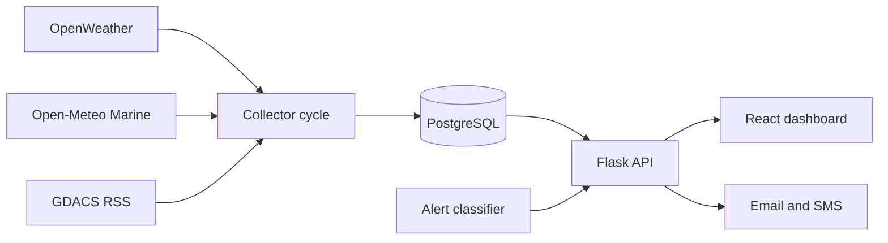

# Coastal Threat Alert System

A prototype coastal monitoring system that combines weather observations, marine forecasts, storm-event feeds, explainable location risk scoring, machine-learning weather alert classification, a Flask API, and a React dashboard.

## Current Data Flow

1. OpenWeather observations are collected for configured coastal cities.
2. Open-Meteo Marine API supplies wave height, modeled sea-level height including tides, sea-surface temperature, and ocean-current velocity.
3. GDACS RSS supplies current tropical-cyclone event metadata when events are present.
4. PostgreSQL stores observations, storm events, risk assessments, alerts, and notification statuses.
5. Risk assessments produce GeoJSON polygons for dashboard rendering.
6. The ML classifier predicts weather alert levels from temperature, humidity, wind speed, pressure, hour, and month.
7. The React dashboard reads the Flask API and refreshes data every 30 seconds.



## Setup

1. Create a PostgreSQL database and apply the migrations in order:

```powershell
python -c "from pathlib import Path; import psycopg2; from config import DB_CONFIG; conn=psycopg2.connect(**DB_CONFIG); conn.autocommit=True; [conn.cursor().execute(Path(path).read_text()) for path in sorted(Path('migrations').glob('*.sql'))]; print('migrations applied')"
```

2. Copy `.env.example` to `credentials.env` and fill in local values. Do not commit real credentials.
3. Install Python dependencies from `requirements.txt`.
4. Start the API:

```powershell
python app.py
```

For a Linux production server, serve the Flask app through a WSGI server:

```powershell
gunicorn --bind 0.0.0.0:5000 wsgi:app
```

5. Start the collector cycle in a separate process:

```powershell
python weather_api_test.py
```

6. Start the dashboard:

```powershell
cd care-dashboard
npm install
npm start
```

For a deployed dashboard, create `care-dashboard/.env` before building:

```text
REACT_APP_API_BASE_URL=https://your-api-domain.example.com
```

Set `APP_DEBUG=false`, configure `CORS_ORIGINS` to the deployed dashboard origin,
and keep all provider credentials in the hosting platform's secret manager.

## Important Endpoints

- `GET /health` - deployment health check
- `GET /latest` - latest weather record
- `GET /history` - weather history
- `GET /coastal/latest` - latest marine observation per city
- `GET /coastal/history?city=Mumbai` - marine history
- `GET /storms` - stored GDACS cyclone events
- `GET /risk-zones?city=Mumbai` - GeoJSON risk zones
- `GET /predict/Mumbai` - ML alert for the latest stored weather record
- `GET /alerts?status=active` - active persisted alerts
- `GET /notifications` - email/SMS delivery statuses
- `PATCH /alerts/<id>/status` - acknowledge, resolve, or expire an alert

## Data Limitations

- Open-Meteo modeled sea-level/tide data has limited accuracy near coasts and is not suitable for navigation.
- GDACS event ingestion is not cyclone prediction; it imports externally issued event information.
- The current ML classifier is a weather alert-level classifier. It does not predict storm surge, cyclone tracks, or abnormal tides.
- Risk polygons are explainable city-level buffers, not official evacuation boundaries.
- Notification delivery requires valid provider credentials and verified recipients.

## Current Classifier Evaluation

The latest reproducible run used 720 synthetic weather records with a 20% test split.
The saved test accuracy is 89.36%. The HIGH class has 0% recall in this run, so the
metric must not be presented as reliable coastal-hazard performance. Replace the
synthetic labels with verified historical observations before using these metrics in
a resume or deployment claim.

The current training window is 90 days when database history is available; otherwise
the collector generates 720 synthetic records at 8 records per day. Features are
temperature, humidity, wind speed, pressure, hour, and month. Labels are LOW,
MEDIUM, HIGH, and CRITICAL values generated from threshold scores, not observed
disaster outcomes.

## Security

Rotate any credentials that were previously exposed. Keep `credentials.env` local and use `.env.example` only as a template.
